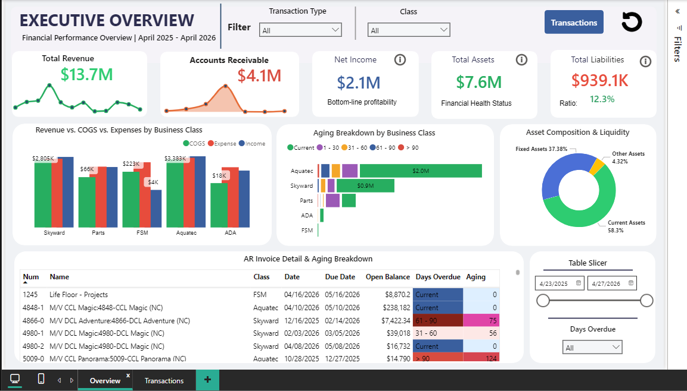
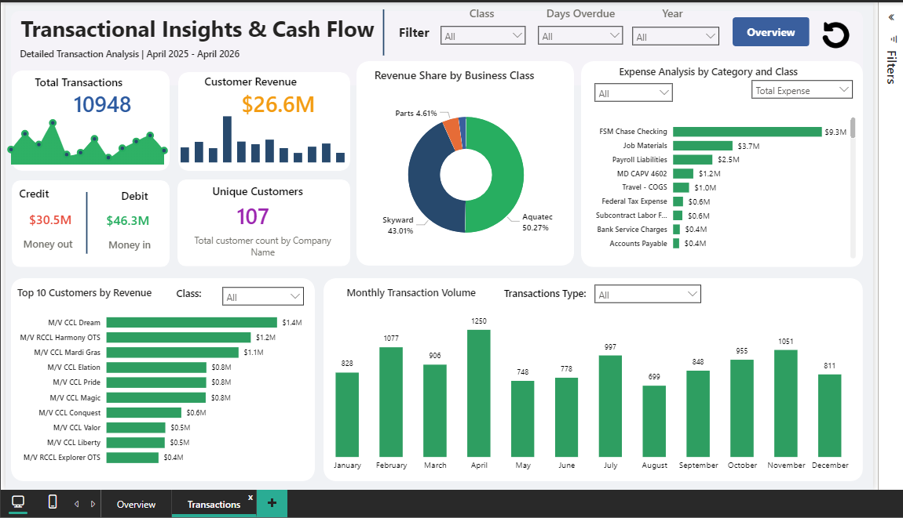

<div align="center">

# 📊 Executive Financial & P&L Statement Dashboard
### Real-Client Business Intelligence Project | Power BI

[](https://powerbi.microsoft.com/)
[](https://docs.microsoft.com/en-us/dax/)
[]()
[](https://github.com/SajeebTheAnalyst)

</div>

---

## 🌟 Project Overview
This repository features a production-grade, interactive **Financial Performance & Profit and Loss (P&L) Statement Dashboard** developed for a real-world corporate client. The solution transforms complex, multi-channel financial datasets into executive-level visual analytics, providing C-suite leadership with real-time visibility into revenue streams, cost structures, and bottom-line profitability.

---

## 🖼️ Dashboard Preview

### 📈 Executive Performance & Summary View (Page 1)


### 📉 Detailed P&L Matrix & Cost Breakdown View (Page 2)


---

## 💡 Key Financial Highlights & Metrics
* 💰 **Total Top-Line Revenue:** **€17.77M** across diversified business streams.
* 🛍️ **Product Sales:** **€11.77M** (66.2% of total revenue).
* 💼 **Consulting Services:** **€6.00M** (33.8% of total revenue).
* 📊 **Gross Profit:** **€10.59M** maintaining a healthy **59.6% Gross Margin**.
* ⚙️ **Operating Profit (EBIT):** **€6.02M** with an **33.9% EBIT Margin**.
* 🎯 **Net Profit:** **€5.50M** solid bottom-line retention (**30.9% Net Margin**).
* 📉 **Cost Optimization:** Uncovered Raw Materials (**€6.45M**) constituting **89.9%** of total COGS (**€7.18M**).
* 📈 **Operating Expenses (Opex):** **€4.57M** tracked across Consulting overhead (**€2.62M**) and R&D (**€1.43M**).

---

## 🛠️ Tech Stack & Methodology
* **BI Tool:** Microsoft Power BI Desktop
* **Data Modeling:** Star Schema architecture, automated relationship mapping.
* **Data Cleaning & Audit:** Advanced cleaning scripts and validation reports (`Cleaning Transactions.xlsx`, `Financial_Data_Reconstruction_Report.pdf`).
* **DAX Formulas:** Advanced time-intelligence measures, dynamic P&L matrix hierarchies, and conditional formatting rules.

---

## 📂 Repository File Structure
```text
├── Power BI Reports.pbix             # Main Power BI interactive dashboard file
├── Page 1.png                        # Preview image for Page 1 overview
├── Page 2.png                        # Preview image for Page 2 detailed P&L
├── Financial_Insights_Report.pdf     # Comprehensive financial audit & insights report
├── Financial_Data_Reconstruction_Report.pdf # Data reconstruction documentation
├── Cleaning Transactions.xlsx        # Cleaned transactional datasets
├── Cleaning Balance Sheet by Class.xlsx # Balance sheet datasets by class
└── README.md                         # Project documentation
